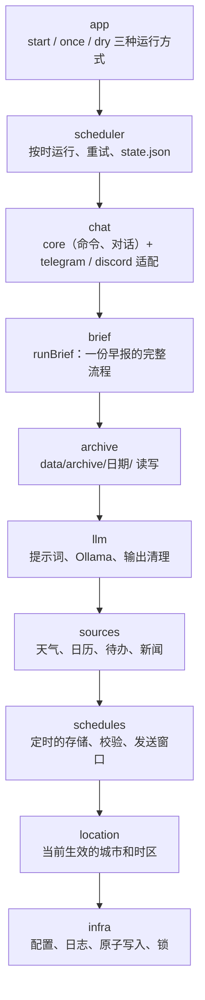
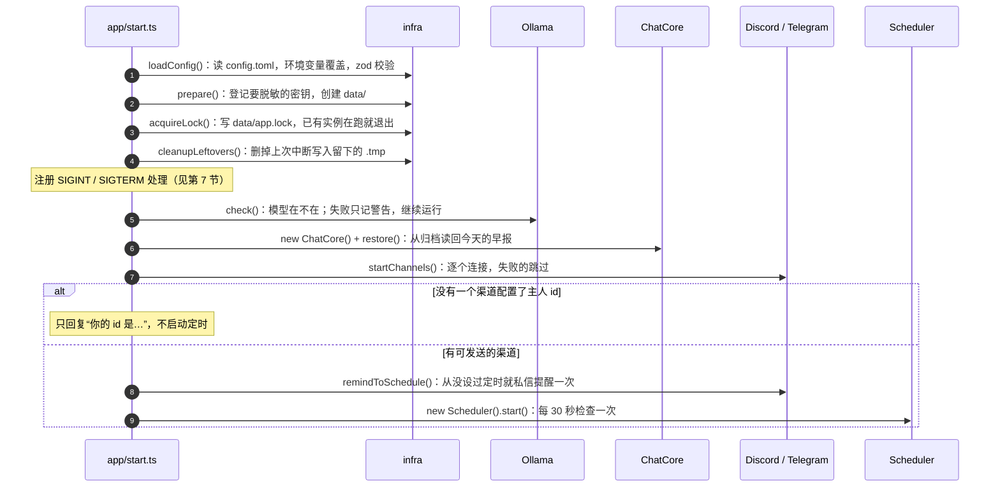
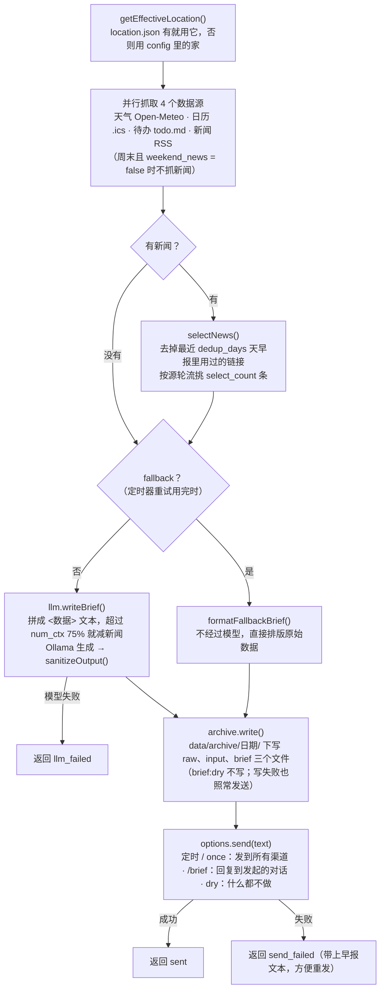
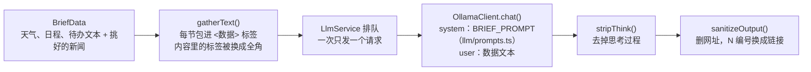
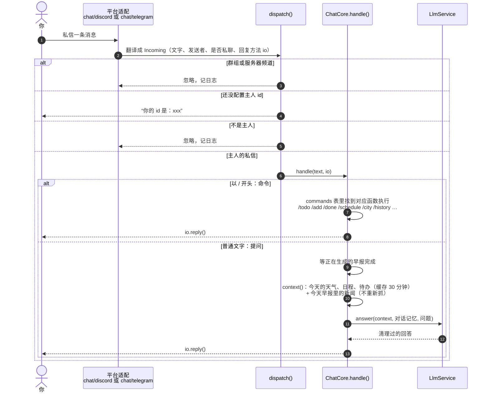
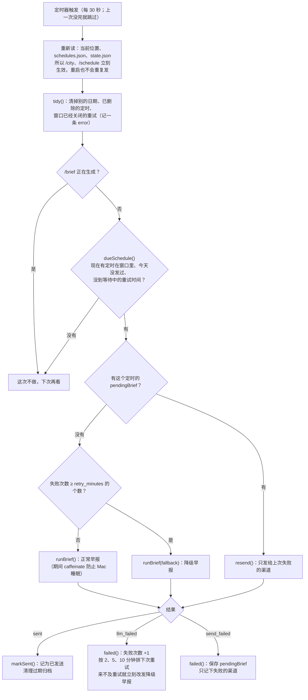

# 代码流程

这份文档说明程序启动后做了什么、一份早报怎么生成、聊天消息怎么处理、定时怎么触发。对应的是阶段 6 完成时的代码（提交 `c4f1a87`），阶段 7 的 Docker 部署还没有写进来。

图用 Mermaid 写，GitHub 和 VS Code（装 Markdown Preview Mermaid Support 插件）都能直接显示。

## 1. 模块和依赖方向

`src/` 下每个顶层目录是一个模块，依赖只能从上往下指；别的模块只能通过 `index.ts` 引用它。`pnpm lint` 会检查这两条。

图里只画了相邻的一层，实际上任何模块都可以引用比它低的模块，例如 `chat` 直接引用 `schedules`（`/schedule` 命令）和 `location`（`/city`）。

## 2. 入口和三种运行方式

`src/index.ts` 只看命令行参数，然后交给 `app/`：

| 命令              | 函数                   | 做什么                                                         |
| ----------------- | ---------------------- | -------------------------------------------------------------- |
| `pnpm start`      | `app/start.ts` `start` | 常驻运行：连聊天渠道、回复消息、按定时发早报                   |
| `pnpm brief:once` | `app/once.ts` `once`   | 生成一份早报发到所有渠道，写归档，然后退出；不算任何一个定时   |
| `pnpm brief:dry`  | `app/dry.ts` `dryRun`  | 生成一份早报，只在终端打印给模型的数据和早报；不发送、不写归档 |

三种方式生成早报都调用同一个 `runBrief`（第 4 节）。

## 3. `pnpm start` 启动过程

## 4. 一份早报怎么生成：`runBrief`

`brief/run.ts` 的 `runBrief` 是整个程序的核心，定时、`/brief`、`brief:once`、`brief:dry` 都用它。它本身不重试，重试由调用者（定时器）决定。

几个要点：

- **数据源从不抛错。** 每个数据源返回 `SourceResult`：`text` 给模型看，`raw` 存进归档，`ok` 表示成功没有。失败时 `text` 是“（天气获取失败：请求超时）”这样的中文，早报照样生成。
- **新闻编号在挑选之后才分配。** 交给模型的新闻编号是 `N1`、`N2`……，`numberNews()` 记下每个编号对应的真实链接。
- **模型输出不可信。** `sanitizeOutput()` 先删掉模型写的所有网址，再把 `[N3]` 换成 `[原文](真实链接)`。所以消息里的链接只能来自订阅的 feed。
- **只有早报里实际提到的新闻才算“用过”**（`usedIds`），没提到的第二天还能出现。

### 模型这一层：`llm/`

`LlmService` 把早报和聊天的请求串成一个队列，并记住当前在做什么。用户提问时如果正在生成早报，机器人会先回一句“正在生成早报，稍后回复你”。

## 5. 聊天消息怎么处理

- **平台无关。** `chat/core/` 不知道消息来自 Discord 还是 Telegram，适配器只负责收发、检查发送者（`dispatch()`）和格式转换（Telegram 要转 HTML，长消息按平台上限切分）。
- **对话记忆**（`chat/core/conversation.ts`）：以今天的早报开头，保留最近 10 轮问答。新早报发出后重新开始；`/clear` 只清问题，保留早报。重启后 `restore()` 从归档读回今天的早报。
- **`/brief`** 也走 `runBrief`，但早报只回复到发起的那个对话；同一时间只允许一份在生成。

## 6. 定时怎么触发

### 数据

- `data/schedules.json`：你用 `/schedule add` 设的定时，每个有 `id`、`time`（如 `08:00`）、`days`（每天、工作日、周末）、`createdAt`。
- `data/state.json`：定时器自己的记录，包括每个定时今天发过没有（`sent`）、失败次数和下次重试时间（`attempts`）、做好了但没送到的早报（`pendingBrief`）。

### 发送窗口

每个定时从它的时间开始，有一个“可以发”的窗口，长度是 `catch_up_hours`（默认 4 小时），但不超过当天下一个定时，也不跨过午夜。例如每天 08:00 和 10:00 两个定时：

```mermaid
gantt
    dateFormat HH:mm
    axisFormat %H:%M
    section 08:00 定时
    窗口（被下一个定时截断）  :08:00, 10:00
    section 10:00 定时
    窗口（catch_up_hours = 4）:10:00, 14:00
```

所以任何时刻最多只有一个定时在窗口里；Mac 睡过几个定时醒来，只补最近的那一个。当天新加的定时从下一次才开始算。

### 每 30 秒一次检查：`Scheduler.check()`

先发送、成功后才记为已发送。如果正好在这两步之间被杀，重启后会再发一份：宁可重复，不要漏发。

## 7. 退出

收到 Ctrl-C（SIGINT）或 SIGTERM 时，`start.ts` 的 `shutdown()`：

1. 停止定时器，等正在生成的定时早报完成；
2. 等正在处理的消息和 `/brief` 完成（`ChatCore.settle()`）；
3. 第 1、2 步最多等 30 秒，超时直接继续；
4. 断开所有聊天渠道，删除 `app.lock`，退出。

中途被强行结束也不会弄坏数据：所有文件都通过 `writeFileAtomic` 先写临时文件再改名，没发出去的早报下次启动会重新生成。

## 8. data/ 里的文件

| 文件                       | 谁写                          | 内容                                       |
| -------------------------- | ----------------------------- | ------------------------------------------ |
| `schedules.json`           | `/schedule` 命令              | 定时列表                                   |
| `state.json`               | 定时器                        | 每个定时的发送和重试记录、首次提醒发过没有 |
| `location.json`            | `/city`，`/home` 时删除       | 旅行时的临时位置                           |
| `todo.md`                  | `/add`、`/done`，或你直接编辑 | 待办                                       |
| `archive/日期/brief-*.md`  | `runBrief`                    | 早报正文，开头是 YAML 属性                 |
| `archive/日期/raw-*.json`  | `runBrief`                    | 各数据源的原始数据、新闻候选和挑选结果     |
| `archive/日期/input-*.txt` | `runBrief`                    | 发给模型的完整提示词和数据                 |
| `app.lock`                 | `pnpm start`                  | 运行中实例的进程号，退出时删除             |

归档文件名里，定时早报带定时的时间（`brief-scheduled-0800.md`），手动早报带生成时的时分秒（`brief-manual-093015.md`）。
